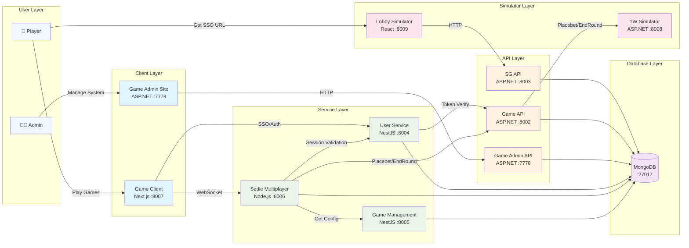
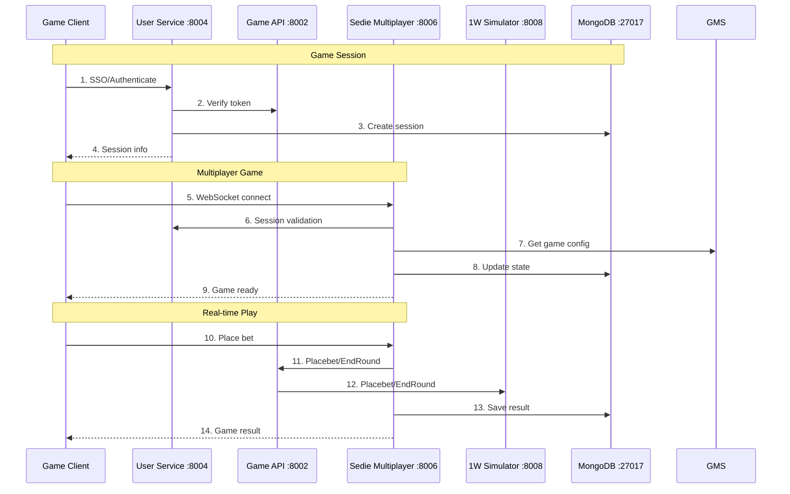

# Local Development Services

## Table of Contents

1. [Prerequisites](#prerequisites)
2. [System Architecture](#system-architecture)
3. [Communication Flow](#communication-flow)
4. [Step-by-Step Setup](#step-by-step-setup)
5. [Service Configuration](#service-configuration)
6. [Troubleshooting](#troubleshooting)
7. [Development Guidelines](#development-guidelines)

## Prerequisites

### Required Software Versions

#### 🟦 **.NET Development**

- **.NET 5.0 SDK** or higher
- **Visual Studio 2019/2022** or **VS Code** with C# extension

#### 🟨 **Node.js Development**

- **Node.js >= 20.x** (Required for game-client)
- **Yarn** package manager
- **NPM** package manager

#### 🟩 **Database**

- **MongoDB** (Community Edition 4.4 or higher)
- **MongoDB Compass** (GUI tool for querying and viewing data)
- MongoDB should be running on default port `27017`

#### 🔧 **Development Tools**

- **Git** for version control
- **Command Prompt** with Administrator privileges
- **Windows 10/11** (for .bat script execution)

#### 📦 **Package Managers**

- **NuGet** (included with .NET SDK)
- **Yarn** (install via `npm install -g yarn`)

### Environment Setup

```bash
# Check Node.js version
node --version  # Should be >= 20.x

# Check .NET version
dotnet --version  # Should be >= 5.0

# Check MongoDB
# Use MongoDB Compass to connect to: mongodb://localhost:27017
# This verifies MongoDB is running and accessible

# Install Yarn globally
npm install -g yarn

# Verify Yarn installation
yarn --version
```

## System Architecture

Below is the high-level architecture of the local development system:



### Service Port Mapping

| Service                   | Technology  | Port  | Purpose                        |
| ------------------------- | ----------- | ----- | ------------------------------ |
| Auth API (Identity)       | ASP.NET 5.0 | 8001  | Authentication & Authorization |
| Game API (Web)            | ASP.NET 5.0 | 8002  | Main game business logic       |
| SG API                    | ASP.NET 5.0 | 8003  | SG system integration          |
| User Service              | NestJS      | 8004  | User management & sessions     |
| Game Management Service   | NestJS      | 8005  | Game configuration & settings  |
| Sedie Multiplayer Service | Node.js     | 8006  | Real-time multiplayer games    |
| Game Client               | Next.js     | 8007  | Frontend web application       |
| 1W Simulator              | ASP.NET 5.0 | 8008  | Third-party API simulation     |
| Lobby Simulator           | React       | 8009  | Lobby testing interface        |
| Game Admin API            | ASP.NET 5.0 | 7778  | Administrative backend         |
| Game Admin Site           | ASP.NET 5.0 | 7779  | Administrative frontend        |
| MongoDB                   | Database    | 27017 | Primary data storage           |

## Communication Flow

The following sequence diagram illustrates how different services communicate during a typical user session:



### Key Communication Patterns

1. **Authentication Flow**: Game Client → User Service (SSO/Authenticate) | User Service → Game API (token verification)
2. **Game Logic Flow**: Sedie Multiplayer Service → Game Management (get config) → Game API (Placebet/EndRound) → 1W Simulator
3. **User Operations**: Game Client → User Service (SSO/Authenticate) → Game API (for token verification)
4. **Real-time Gaming**: Client ↔ Sedie Multiplayer Service (WebSocket) → User Service (session validation) → Game API, Auth API
5. **Admin Operations**: Game Admin API → User Service, Game API, Sedie Multiplayer Service, Game Management Service
6. **Data Persistence**: All services connect directly to MongoDB for data storage

## Step-by-Step Setup

### Phase 1: Environment Preparation

#### 1.1 Install Prerequisites

```bash
# Install Node.js (>= 20.x)
# Download from: https://nodejs.org/

# Install .NET 5.0 SDK
# Download from: https://dotnet.microsoft.com/download/dotnet/5.0

# Install MongoDB Community Edition
# Download from: https://www.mongodb.com/try/download/community

# Install MongoDB Compass (GUI tool)
# Download from: https://www.mongodb.com/try/download/compass

# Install Yarn globally
npm install -g yarn
```

#### 1.2 Verify Installations

```bash
# Check versions
node --version    # Should show >= 20.x
dotnet --version  # Should show >= 5.0.x
yarn --version    # Should show latest version

# Check MongoDB connection
# Open MongoDB Compass and connect to: mongodb://localhost:27017
# This verifies MongoDB (>= 4.4.x) is running and accessible
```

#### 1.3 Start MongoDB

```bash
# Start MongoDB service (Windows)
net start MongoDB

# Or start manually
mongod --dbpath "C:\data\db"

# Verify MongoDB is running
mongo --eval "db.runCommand({connectionStatus: 1})"

# Connect with MongoDB Compass (optional)
# Open MongoDB Compass and connect to: mongodb://localhost:27017
```

### Phase 2: Repository Setup

#### 2.1 Clone and Navigate

```bash
# Clone the repository
git clone <repository-url>
cd system-training

# Verify directory structure
ls services/
```

#### 2.2 Set NPM Registry (Important!)

```bash
# Set company npm registry for all services
npm set registry https://npm.lumigame.com/

# Verify registry setting
npm config get registry
```

### Phase 3: Quick Start (Automated)

#### 3.1 Using run-services.bat (Recommended)

```cmd
# Open Command Prompt as Administrator
# Navigate to project root
cd path\to\system-training

# Run the automated setup script
run-services.bat
```

The script will:

- ✅ Set npm registry
- ✅ Import database data
- ✅ Start all services in correct order
- ✅ Open separate terminal windows for each service
- ✅ Display service URLs

### Phase 4: Manual Setup (Alternative)

If you prefer manual control or the automated script fails:

#### 4.1 Database Setup

```bash
# Navigate to database scripts
cd db-scripts

# Install dependencies and import data
npm install
npm run start

# Return to root
cd ..
```

#### 4.2 Start Services in Order

**Step 1: Start Auth API (Port 8001)**

```bash
cd services/api-auth/L1.IdentityServerApi
dotnet build
dotnet run
# Wait for "Now listening on: http://localhost:8001"
```

**Step 2: Start Game API (Port 8002)**

```bash
# New terminal window
cd services/api-auth/L1.WebApi
dotnet build
dotnet run
# Wait for "Now listening on: http://localhost:8002"
```

**Step 3: Start SG API (Port 8003)**

```bash
# New terminal window
cd services/sg-api/SG.Api
dotnet build
dotnet run
```

**Step 4: Start User Service (Port 8004)**

```bash
# New terminal window
cd services/user-service
yarn install
yarn start
# Wait for "Application is running on: http://localhost:8004"
```

**Step 5: Start Game Management Service (Port 8005)**

```bash
# New terminal window
cd services/game-management-service
yarn install
yarn start:dev
```

**Step 6: Start Sedie Multiplayer Service (Port 8006)**

```bash
# New terminal window
cd services/services/sedie-multiplayer-service
yarn install
npm run dev
```

**Step 7: Start Game Client (Port 8007)**

```bash
# New terminal window
cd services/game-client
yarn install
yarn dev
# Wait for "ready - started server on 0.0.0.0:8007"
```

**Step 8: Start 1W Simulator (Port 8008)**

```bash
# New terminal window
cd services/ow-simulator/OW.ApiSimulator
dotnet build
dotnet run
```

**Step 9: Start Lobby Simulator (Port 8009)**

```bash
# New terminal window
cd services/lobby-simulator
yarn install
set NODE_OPTIONS=--openssl-legacy-provider
yarn dev
```

**Step 10: Start Game Admin Services (Optional)**

```bash
# Game Admin API (Port 7778)
cd services/game-admin/src/GamesAdmin.Api
dotnet build
dotnet run

# Game Admin Site (Port 7779)
# New terminal window
cd services/game-admin/src/GamesAdmin.Site
dotnet build
dotnet run
```

### Phase 5: Verification

#### 5.1 Check Service Health

Visit these URLs to verify services are running:

- **Auth API**: http://localhost:8001/.well-known/openid_configuration
- **Game API**: http://localhost:8002/swagger
- **SG API**: http://localhost:8003/swagger
- **User Service**: http://localhost:8004/api
- **Game Management**: http://localhost:8005/api
- **Game Client**: http://localhost:8007
- **1W Simulator**: http://localhost:8008/swagger
- **Lobby Simulator**: http://localhost:8009
- **Game Admin**: http://localhost:7779

#### 5.2 Test Basic Functionality

```bash
# Test Auth API
curl http://localhost:8001/.well-known/openid_configuration

# Test User Service
curl http://localhost:8004/api

# Test Game Client
curl http://localhost:8007/health
```

## Service Configuration

### Environment Variables

Each service has its own configuration:

#### User Service (.env)

```env
PORT=8004
ENV=LOCAL
DATABASE_URI=mongodb://localhost:27017/
AUTH_URI=http://localhost:8001
VALID_ISSUERS="http://localhost:8001"
SYSTEM_TYPE=LOCAL
```

#### Game Management Service (.env)

```env
PORT=8005
ENV=LOCAL
DATABASE_URI=mongodb://localhost:27017/
AUTH_URI=http://localhost:8001
VALID_ISSUERS="http://localhost:8001"
SYSTEM_TYPE=LOCAL
```

#### Game Client Configuration

**File**: `services/game-client/configs.json`

```json
{
  "serverDomainMapper": {
    "localhost": "localhost:8007"
  },
  "proxy": {
    "ssl": false,
    "subDomain": "",
    "path": ""
  },
  "socketGatewayPath": "gateway"
}
```

### WebSocket Configuration

**Game Settings**: `services/game-client/game-settings.json`

```json
{
  "148": {
    "gameName": "SeDieMultiplayer",
    "socketInfo": {
      "namespace": "sediemultiplayer",
      "path": "sediemultiplayer",
      "serviceEndpoint": "http://localhost:8006"
    }
  }
}
```

## Troubleshooting

### Common Issues and Solutions

#### 🔴 **Port Already in Use**

```bash
# Find process using port
netstat -ano | findstr :8001

# Kill process (replace PID)
taskkill /PID <PID> /F

# Or use different port in configuration
```

#### 🔴 **MongoDB Connection Failed**

```bash
# Check if MongoDB is running
tasklist | findstr mongod

# Start MongoDB service
net start MongoDB

# Check MongoDB logs
# Look in: C:\Program Files\MongoDB\Server\{version}\log\

# Use MongoDB Compass to verify connection
# Open MongoDB Compass and connect to: mongodb://localhost:27017
# You should see the imported databases and collections
```

#### 🔴 **NPM Registry Issues**

```bash
# Reset to default registry
npm config set registry https://registry.npmjs.org/

# Or use company registry
npm set registry https://npm.lumigame.com/

# Clear npm cache
npm cache clean --force
```

#### 🔴 **.NET Build Errors**

```bash
# Clean and rebuild
dotnet clean
dotnet restore
dotnet build

# Check .NET version
dotnet --version
```

#### 🔴 **Node.js Version Conflicts**

```bash
# Install Node Version Manager (nvm)
# Use specific Node version for different services

# For database scripts (requires Node 18.20.7)
nvm use 18.20.7

# For game client (requires Node >= 20.x)
nvm use 20
```

#### 🔴 **WebSocket Connection Failed**

```bash
# Check console logs in Game Client
# Should see: [SOCKET] Direct connection to service: http://localhost:8006/user/sediemultiplayer

# Verify Sedie Multiplayer Service is running
curl http://localhost:8006

# Check firewall settings
# Ensure localhost connections are allowed
```

#### 🔴 **Authentication Failed**

```bash
# Check Auth API is running first
curl http://localhost:8001/.well-known/openid_configuration

# Check User Service logs for authentication errors
# Look for [AUTH FAILED] or [AUTH SUCCESS] messages

# Verify JWT token configuration in all services
```

### Debug Logging

Enable detailed logging for troubleshooting:

#### Game Client

```javascript
// Check browser console for:
// [SOCKET] Direct connection messages
// [AUTH SUCCESS/FAILED] messages
// Network tab for API calls
```

#### User Service

```typescript
// Console will show:
// [AUTH SUCCESS] Authentication Successful
// [AUTH FAILED] Authentication Failed
// [UM AUTH FAILED] UM Authentication Failed
```

### Performance Optimization

#### 🚀 **Fast Startup Tips**

1. **Use SSD**: Install on SSD for faster builds
2. **Parallel Startup**: Use `run-services.bat` for parallel service startup
3. **Skip Tests**: Use `--no-tests` flag for faster builds
4. **Incremental Builds**: Don't clean unless necessary

#### 🚀 **Development Workflow**

1. **Keep Core Services Running**: Auth, User Service, MongoDB
2. **Restart Only Changed Services**: No need to restart all services
3. **Use Hot Reload**: Game Client supports hot reload
4. **Database Persistence**: MongoDB data persists across restarts

## Development Guidelines

### 🔧 **Code Changes**

- **Frontend**: Game Client supports hot reload (changes reflect immediately)
- **Backend APIs**: Restart specific service after code changes
- **Database**: Changes persist across service restarts

### 🔧 **Testing Strategy**

- **Unit Tests**: Run in individual service directories
- **Integration Tests**: Use Lobby Simulator for end-to-end testing
- **API Testing**: Use Swagger UI endpoints for API testing

### 🔧 **Port Management**

- **Never change ports** without updating all dependent configurations
- **Check port conflicts** before starting services
- **Use consistent ports** across all environments

### 🔧 **Service Dependencies**

```
Core Flow:
Auth API (8001) ← Game API (8002) ← Sedie Multiplayer (8006)
Game Client (8007) → User Service (8004) (SSO/Authenticate)
User Service (8004) → Game API (8002) (token verification)
User Service (8004) ↔ Auth API (8001) (for JWT verification)
Sedie Multiplayer (8006) → Game Management (8005) (get game config)

Service Interconnections:
Sedie Multiplayer (8006) → Game API (8002), User Service (8004), Auth API (8001), Game Management (8005)
Game Admin API (7778) → User Service (8004), Game API (8002), Sedie Multiplayer (8006), Game Management (8005)

Database:
MongoDB (27017) ← All Services (direct connection)

Client Access:
Game Client (8007) → All Services (HTTP/WebSocket)
```

### 🔧 **Best Practices**

1. **Always start Auth API first** (other services depend on it)
2. **Wait for service startup** before starting dependent services
3. **Check logs** for startup confirmation messages
4. **Use Administrator privileges** for port binding
5. **Keep MongoDB running** throughout development session

---

## Quick Reference

### 📋 **Service Startup Checklist**

- [ ] MongoDB running (port 27017)
- [ ] Auth API running (port 8001)
- [ ] User Service running (port 8004)
- [ ] Game API running (port 8002)
- [ ] Game Client running (port 8007)
- [ ] Other services as needed

### 📋 **Essential URLs**

- **Game Client**: http://localhost:8007
- **Lobby Simulator**: http://localhost:8009
- **Game Admin**: http://localhost:7779
- **API Documentation**: http://localhost:8002/swagger
- **MongoDB Compass**: mongodb://localhost:27017

### 📋 **Common Commands**

```bash
# Quick health check
curl http://localhost:8007/health

# Check all services
netstat -an | findstr "800[1-9]\|777[8-9]"

# Restart MongoDB
net stop MongoDB && net start MongoDB

# Clean build
dotnet clean && dotnet build
```

Happy coding! 🎮✨
