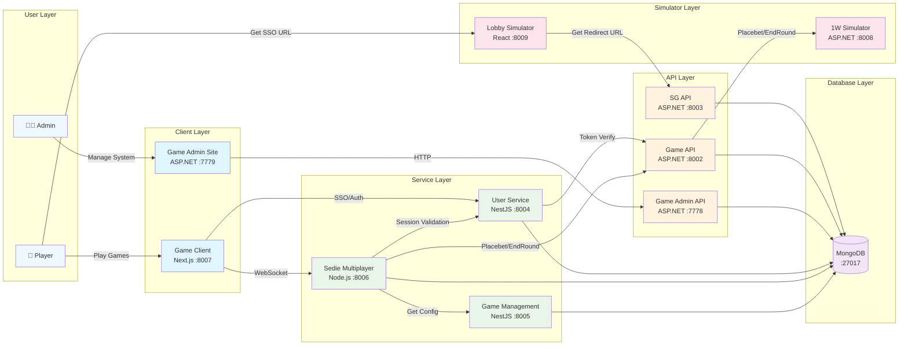
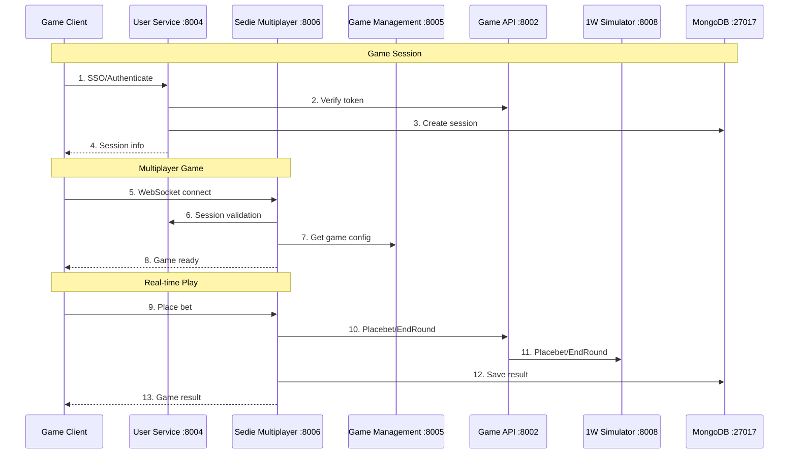

# Gaming Platform - New Team Member Training

> **🎯 Training Purpose**: Help new team members understand and set up the gaming platform locally for hands-on learning and familiarization.

This training repository provides everything you need to run the complete gaming platform on your local machine. By following this guide, you'll gain hands-on experience with our multi-service architecture, understand how different components interact, and be ready to contribute to the team.

## Table of Contents

1. [Prerequisites](#prerequisites)
2. [System Architecture](#system-architecture)
3. [Communication Flow](#communication-flow)
4. [Step-by-Step Setup](#step-by-step-setup)
5. [Service Configuration](#service-configuration)
6. [Troubleshooting](#troubleshooting)
7. [Development Guidelines](#development-guidelines)

## Prerequisites

### Required Software Versions

#### 🟦 **.NET Development**

- **.NET 5.0 SDK** or higher
- **Visual Studio 2019/2022** or **VS Code** with C# extension

#### 🟨 **Node.js Development**

- **Node.js >= 20.x**
- **Yarn** package manager
- **NPM** package manager

#### 🟩 **Database**

- **MongoDB** (Community Edition 4.4 or higher)
- **MongoDB Compass** (GUI tool for querying and viewing data)
- MongoDB should be running on default port `27017`

#### 🔧 **Development Tools**

- **Git** for version control
- **Command Prompt** with Administrator privileges
- **Windows 10/11** (for .bat script execution)

#### 📦 **Package Managers**

- **NuGet** (included with .NET SDK)
- **Yarn** (install via `npm install -g yarn`)

### Environment Setup

```bash
# Check Node.js version
node --version  # Should be >= 20.x

# Check .NET version
dotnet --version  # Should be >= 5.0

# Check MongoDB
# Use MongoDB Compass to connect to: mongodb://localhost:27017
# This verifies MongoDB is running and accessible

# Install Yarn globally
npm install -g yarn

# Verify Yarn installation
yarn --version
```

## System Architecture

Below is the high-level architecture of the local development system:



### Service Overview & Details

This comprehensive table provides all the essential information about each service in the gaming platform:

| Service                       | Technology  | Port  | Layer     | Primary Purpose                                            | Key Features                                                                                                                                                                                                                                                                                                                                                                                                                                                                                                      | Data Storage                                                                                     |
| ----------------------------- | ----------- | ----- | --------- | ---------------------------------------------------------- | ----------------------------------------------------------------------------------------------------------------------------------------------------------------------------------------------------------------------------------------------------------------------------------------------------------------------------------------------------------------------------------------------------------------------------------------------------------------------------------------------------------------- | ------------------------------------------------------------------------------------------------ |
| **Auth API (Identity)**       | ASP.NET 5.0 | 8001  | API       | **Service-to-Service Authentication & Authorization**      | • JWT token generation and validation for inter-service communication<br>• OpenID Connect implementation for service authentication<br>• Service identity management and token validation<br>• **NOT for end-user authentication**                                                                                                                                                                                                                                                                                | Service authentication logs, service credentials, inter-service tokens                           |
| **Game API (Web)**            | ASP.NET 5.0 | 8002  | API       | **SSO Token Validation & External Operator API Gateway**   | • SSO token validation via AuthVerificationController<br>• Receives game service requests (get balance, placebet, endround)<br>• Forwards requests to external operator APIs (1W Simulator)<br>• **NOT handling game business logic**<br>• Acts as proxy between internal services and external gaming providers<br>• Manages communication with SabaClub gaming provider APIs                                                                                                                                    | Request/response logs, token validation records, external API communication logs                 |
| **SG API**                    | ASP.NET 5.0 | 8003  | API       | **SABA.games API Integration & External Operator Gateway** | • Handles requests from external operator APIs (SignIn, Retrieve End Round, Get Daily Summary)<br>• Manages SABA.games system integration and authentication<br>• Processes external operator data and transactions<br>• Provides SABA.games API endpoints for external systems<br>• Supports multiple currencies and operator configurations<br>• **NOT for internal SSO authentication**                                                                                                                        | SABA.games API configurations, external operator logs, transaction data, daily summaries         |
| **User Service**              | NestJS      | 8004  | Service   | User management, authentication, and session handling      | • SSO authentication and session management via signIn method<br>• User profile and account management<br>• Session validation for real-time games<br>• Token verification with 1W Simulator (OW API Client)<br>• User data persistence and retrieval<br>• Partner configuration and currency group management<br>• UM (User Management) service integration                                                                                                                                                      | User profiles, sessions, authentication data, and user configurations                            |
| **Game Management Service**   | NestJS      | 8005  | Service   | Comprehensive game and system configuration management     | • Game configuration management (GameConfigsModule)<br>• Currency and currency group management<br>• User management and notifications<br>• Promotion and jackpot management<br>• Exchange rate management<br>• Operator configuration and domain management<br>• Archive status and aggregation services                                                                                                                                                                                                         | Game configurations, currencies, promotions, jackpots, and system settings                       |
| **Sedie Multiplayer Service** | Node.js     | 8006  | Service   | **Sample Game Service for Demo & Learning**                | • **Reference implementation for new team members to study**<br>• WebSocket-based real-time communication<br>• Multiplayer dice game session management (SeDieMultiplayer)<br>• Real-time game state synchronization<br>• Betting choices: even, odd, red2, red3, red4, white3, white4<br>• 23-second round duration with 18-second betting phase<br>• Bot integration with configurable ratios<br>• Provably fair gaming with server seed management<br>• **Template for implementing new game services**        | Real-time game states, betting history, and multiplayer sessions                                 |
| **Game Client**               | Next.js     | 8007  | Client    | **Demo Game Client for Learning & Reference**              | • **Reference implementation for new team members to study game client development**<br>• Demonstrates complete game flow code and architecture<br>• Shows communication patterns between game client and game services<br>• Real-time game interface with WebSocket connections to Sedie Multiplayer<br>• SSO authentication integration with User Service<br>• Game lobby and session management<br>• Responsive design for desktop and mobile gaming<br>• **Template for implementing new game clients**       | Frontend assets, game flow code examples, client-service communication patterns                  |
| **1W Simulator**              | ASP.NET 5.0 | 8008  | Simulator | **External Operator API Simulation for Testing**           | • **Simulates external operator APIs to enable full game flow testing**<br>• Allows complete game flow testing without real external operator integration<br>• Handles Placebet and EndRound operations for SabaClub gaming provider simulation<br>• Customer management and balance simulation<br>• Provides realistic game outcome simulation<br>• Supports multiple operators and currencies<br>• Token verification and authentication simulation<br>• **Essential for development and testing environments** | Simulated gaming data, external operator configurations, and test scenarios                      |
| **Lobby Simulator**           | React       | 8009  | Simulator | **External Operator Player Site Simulation**               | • **Acts as a Player Site page of the External Operator**<br>• Requests SG API to make SignIn requests for testing<br>• Enables full flow testing from SignIn to playing games<br>• Simulates external operator player portal interface<br>• SSO URL generation and testing<br>• User flow testing and validation<br>• **Essential for testing complete authentication and game flow**                                                                                                                            | Test data, external operator player site configurations, and simulation scenarios                |
| **Game Admin API**            | ASP.NET 5.0 | 7778  | API       | Backend services for administrative operations             | • User management and administrative functions<br>• System configuration management<br>• Analytics and reporting endpoints<br>• Administrative authentication and authorization                                                                                                                                                                                                                                                                                                                                   | Administrative data and system configurations                                                    |
| **Game Admin Site**           | ASP.NET 5.0 | 7779  | Client    | Administrative interface for system management             | • User account management and monitoring<br>• Game configuration and settings management<br>• System health monitoring and analytics<br>• Administrative controls and permissions                                                                                                                                                                                                                                                                                                                                 | Administrative UI and configurations                                                             |
| **MongoDB**                   | Database    | 27017 | Database  | Primary data storage for all services                      | • Document-based storage for flexible data structures<br>• High-performance read/write operations<br>• Scalable architecture for gaming data<br>• Real-time data access for multiplayer games                                                                                                                                                                                                                                                                                                                     | User data, game states, transactions, configurations, sessions, currencies, promotions, jackpots |

**Layer Classification:**

- **Client Layer**: User-facing applications (Game Client, Game Admin Site)
- **API Layer**: Backend APIs for business logic (Auth API, Game API, SG API, Game Admin API)
- **Service Layer**: Core business services (User Service, Game Management Service, Sedie Multiplayer Service)
- **Simulator Layer**: Development and testing tools (1W Simulator, Lobby Simulator)
- **Database Layer**: Data persistence (MongoDB)

## Communication Flow

The following sequence diagram illustrates how different services communicate during a typical user session:



### Key Communication Patterns

1. **Authentication Flow**: Game Client → User Service (SSO/Authenticate) | User Service → Game API (token verification)
2. **Game Logic Flow**: Sedie Multiplayer Service → Game Management (get config) → Game API (Placebet/EndRound) → 1W Simulator
3. **User Operations**: Game Client → User Service (SSO/Authenticate) → Game API (for token verification)
4. **Real-time Gaming**: Client ↔ Sedie Multiplayer Service (WebSocket) → User Service (session validation) → Game API, Auth API
5. **Admin Operations**: Game Admin API → User Service, Game API, Sedie Multiplayer Service, Game Management Service
6. **Data Persistence**: All services connect directly to MongoDB for data storage

## Step-by-Step Setup

### Phase 1: Environment Preparation

#### 1.1 Install Prerequisites

```bash
# Install Node.js (>= 20.x)
# Download from: https://nodejs.org/

# Install .NET 5.0 SDK
# Download from: https://dotnet.microsoft.com/download/dotnet/5.0

# Install MongoDB Community Edition
# Download from: https://www.mongodb.com/try/download/community

# Install MongoDB Compass (GUI tool)
# Download from: https://www.mongodb.com/try/download/compass

# Install Yarn globally
npm install -g yarn
```

#### 1.2 Verify Installations

```bash
# Check versions
node --version    # Should show >= 20.x
dotnet --version  # Should show >= 5.0.x
yarn --version    # Should show latest version

# Check MongoDB connection
# Open MongoDB Compass and connect to: mongodb://localhost:27017
# This verifies MongoDB (>= 4.4.x) is running and accessible
```

#### 1.3 Start MongoDB

```bash
# Start MongoDB Windows Service (Recommended)
net start MongoDB

# Verify MongoDB is running
mongo --eval "db.runCommand({connectionStatus: 1})"

# Connect with MongoDB Compass (optional)
# Open MongoDB Compass and connect to: mongodb://localhost:27017
```

**Note**: Use the Windows service for MongoDB startup. Manual startup with `mongod` is not recommended for development.

### Phase 2: Repository Setup

#### 2.1 Clone and Navigate

```bash
# Clone the repository
git clone <repository-url>
cd system-training

# Verify directory structure
dir services
# You should see: api-auth, game-admin, game-client, game-management-service,
# lobby-simulator, ow-simulator, services, sg-api, user-service
```

#### 2.2 Set NPM Registry (Important!)

```bash
# Set company npm registry for all services
npm set registry https://npm.lumigame.com/

# Verify registry setting
npm config get registry
```

### Phase 3: Quick Start (Automated)

#### 3.1 Using run-services.bat (Recommended)

```cmd
# Open Command Prompt as Administrator
# Navigate to project root
cd path\to\system-training

# Run the automated setup script
run-services.bat
```

The script will:

- ✅ Set npm registry
- ✅ Import database data
- ✅ Start all services in correct order
- ✅ Open separate terminal windows for each service
- ✅ Display service URLs

### Phase 4: Manual Setup (Alternative)

If you prefer manual control or the automated script fails:

#### 4.1 Database Setup

```bash
# Navigate to database scripts
cd db-scripts

# Install dependencies and import data
npm install
npm run start

# Return to root
cd ..
```

#### 4.2 Start Services in Order

**Step 1: Start Auth API (Port 8001)**

```bash
cd services/api-auth/L1.IdentityServerApi
dotnet build
dotnet run
# Wait for "Now listening on: http://localhost:8001"
```

**Step 2: Start Game API (Port 8002)**

```bash
# New terminal window
cd services/api-auth/L1.WebApi
dotnet build
dotnet run
# Wait for "Now listening on: http://localhost:8002"
```

**Step 3: Start SG API (Port 8003)**

```bash
# New terminal window
cd services/sg-api/SG.Api
dotnet build
dotnet run
```

**Step 4: Start User Service (Port 8004)**

```bash
# New terminal window
cd services/user-service
yarn install
yarn start
# Wait for "Application is running on: http://localhost:8004"
```

**Step 5: Start Game Management Service (Port 8005)**

```bash
# New terminal window
cd services/game-management-service
yarn install
yarn start:dev
```

**Step 6: Start Sedie Multiplayer Service (Port 8006)**

```bash
# New terminal window
cd services/services/sedie-multiplayer-service
yarn install
npm run dev
```

**Step 7: Start Game Client (Port 8007)**

```bash
# New terminal window
cd services/game-client
yarn install
yarn dev
# Wait for "ready - started server on 0.0.0.0:8007"
```

**Step 8: Start 1W Simulator (Port 8008)**

```bash
# New terminal window
cd services/ow-simulator/OW.ApiSimulator
dotnet build
dotnet run
```

**Step 9: Start Lobby Simulator (Port 8009)**

```bash
# New terminal window
cd services/lobby-simulator
yarn install
set NODE_OPTIONS=--openssl-legacy-provider
yarn dev
```

**Step 10: Start Game Admin Services (Optional)**

```bash
# Game Admin API (Port 7778)
cd services/game-admin/src/GamesAdmin.Api
dotnet build
dotnet run

# Game Admin Site (Port 7779)
# New terminal window
cd services/game-admin/src/GamesAdmin.Site
dotnet build
dotnet run
```

### Phase 5: Verification

#### 5.1 Check Service Health

Visit these URLs to verify services are running:

- **Auth API**: http://localhost:8001/.well-known/openid_configuration
- **Game API**: http://localhost:8002/swagger
- **SG API**: http://localhost:8003/swagger
- **User Service**: http://localhost:8004/api
- **Game Management**: http://localhost:8005/api
- **Game Client**: http://localhost:8007
- **1W Simulator**: http://localhost:8008/swagger
- **Lobby Simulator**: http://localhost:8009
- **Game Admin**: http://localhost:7779

#### 5.2 Test Basic Functionality

```bash
# Test Auth API
curl http://localhost:8001/.well-known/openid_configuration

# Test User Service
curl http://localhost:8004/api

# Test Game Client
curl http://localhost:8007/health
```

#### 5.3 Test Game Flow with Lobby Simulator

1. **Open Lobby Simulator**: Navigate to http://localhost:8009/signin
2. **Get SSO Token**: Click on the "Get Token" button to generate an SSO URL
3. **Test Authentication**: The system will redirect you through the authentication flow
4. **Access Game**: Once authenticated, you can access and test the multiplayer dice game
5. **Verify Real-time Features**: Test WebSocket connections and real-time game functionality

**Note**: This step verifies the complete authentication flow and game access through the lobby system.

#### 5.4 Test Admin Site

1. **Open Game Admin Site**: Navigate to http://localhost:7779
2. **Login with Admin Credentials**:
   - **Username**: `superadmin`
   - **Password**: `1234aa`
3. **Verify Admin Access**: Once logged in, you should have access to:
   - User account management and monitoring
   - Game configuration and settings management
   - Administrative controls and permissions

**Note**: This step verifies that the administrative interface is working correctly and that you have proper access to system management functions.

## Service Configuration

### Environment Variables

Each service has its own configuration:

#### User Service (.env)

```env
PORT=8004
ENV=LOCAL
DATABASE_URI=mongodb://localhost:27017/
AUTH_URI=http://localhost:8001
VALID_ISSUERS="http://localhost:8001"
SYSTEM_TYPE=LOCAL
```

#### Game Management Service (.env)

```env
PORT=8005
ENV=LOCAL
DATABASE_URI=mongodb://localhost:27017/
AUTH_URI=http://localhost:8001
VALID_ISSUERS="http://localhost:8001"
SYSTEM_TYPE=LOCAL
```

#### Game Client Configuration

**File**: `services/game-client/public/c.js`

```javascript
window.c = {
  serverDomainMapper: {
    localhost: "localhost:8007",
  },
  proxy: {
    ssl: false,
    subDomain: "",
    path: "",
  },
  socketGatewayPath: "gateway",
};
```

## Troubleshooting

### Common Issues and Solutions

#### 🔴 **Port Already in Use**

```bash
# Find process using port
netstat -ano | findstr :8001

# Kill process (replace PID)
taskkill /PID <PID> /F

# Or use different port in configuration
```

#### 🔴 **MongoDB Connection Failed**

```bash
# Check if MongoDB is running
tasklist | findstr mongod

# Start MongoDB service
net start MongoDB

# Check MongoDB logs
# Look in: C:\Program Files\MongoDB\Server\{version}\log\

# Use MongoDB Compass to verify connection
# Open MongoDB Compass and connect to: mongodb://localhost:27017
# You should see the imported databases and collections
```

#### 🔴 **NPM Registry Issues**

```bash
# Reset to default registry
npm config set registry https://registry.npmjs.org/

# Or use company registry
npm set registry https://npm.lumigame.com/

# Clear npm cache
npm cache clean --force
```

#### 🔴 **.NET Build Errors**

```bash
# Clean and rebuild
dotnet clean
dotnet restore
dotnet build

# Check .NET version
dotnet --version
```

#### 🔴 **Node.js Version Conflicts**

```bash
# Install Node Version Manager (nvm)
# Use specific Node version for different services

# For database scripts (requires Node 18.20.7)
nvm use 18.20.7

# For game client (requires Node >= 20.x)
nvm use 20
```

#### 🔴 **WebSocket Connection Failed**

```bash
# Check console logs in Game Client
# Should see: [SOCKET] Direct connection to service: http://localhost:8006/user/sediemultiplayer

# Verify Sedie Multiplayer Service is running
curl http://localhost:8006

# Check firewall settings
# Ensure localhost connections are allowed
```

#### 🔴 **Authentication Failed**

```bash
# Check Auth API is running first
curl http://localhost:8001/.well-known/openid_configuration

# Check User Service logs for authentication errors
# Look for [AUTH FAILED] or [AUTH SUCCESS] messages

# Verify JWT token configuration in all services
```

## Development Guidelines

### 🔧 **Code Changes**

- **Frontend**: Game Client supports hot reload (changes reflect immediately)
- **Backend APIs**: Restart specific service after code changes
- **Database**: Changes persist across service restarts

### 🔧 **Testing Strategy**

- **Unit Tests**: Run in individual service directories
- **Integration Tests**: Use Lobby Simulator for end-to-end testing
- **API Testing**: Use Swagger UI endpoints for API testing

### 🔧 **Port Management**

- **Never change ports** without updating all dependent configurations
- **Check port conflicts** before starting services
- **Use consistent ports** across all environments

### 🔧 **Service Dependencies**

```
Core Flow:
Auth API (8001) ← Game API (8002) ← Sedie Multiplayer (8006)
Game Client (8007) → User Service (8004) (SSO/Authenticate)
User Service (8004) → Game API (8002) (token verification)
User Service (8004) ↔ Auth API (8001) (for JWT verification)
Sedie Multiplayer (8006) → Game Management (8005) (get game config)

Service Interconnections:
Sedie Multiplayer (8006) → Game API (8002), User Service (8004), Auth API (8001), Game Management (8005)
Game Admin API (7778) → User Service (8004), Game API (8002), Sedie Multiplayer (8006), Game Management (8005)

Database:
MongoDB (27017) ← All Services (direct connection)

Client Access:
Game Client (8007) → All Services (HTTP/WebSocket)
```

### 🔧 **Best Practices**

1. **Always start Auth API first** (other services depend on it)
2. **Wait for service startup** before starting dependent services
3. **Check logs** for startup confirmation messages
4. **Use Administrator privileges** for port binding
5. **Keep MongoDB running** throughout development session

---

## Quick Reference

### 📋 **Service Startup Checklist**

- [ ] MongoDB running (port 27017)
- [ ] Auth API running (port 8001)
- [ ] User Service running (port 8004)
- [ ] Game API running (port 8002)
- [ ] Game Client running (port 8007)
- [ ] Other services as needed

### 📋 **Essential URLs**

- **Game Client**: http://localhost:8007
- **Lobby Simulator**: http://localhost:8009
- **Game Admin**: http://localhost:7779
- **API Documentation**: http://localhost:8002/swagger
- **MongoDB Compass**: mongodb://localhost:27017

### 📋 **Common Commands**

```bash
# Quick health check
curl http://localhost:8007/health

# Check all services
netstat -an | findstr "800[1-9]\|777[8-9]"

# Restart MongoDB
net stop MongoDB && net start MongoDB

# Clean build
dotnet clean && dotnet build
```

Happy coding! 🎮✨
