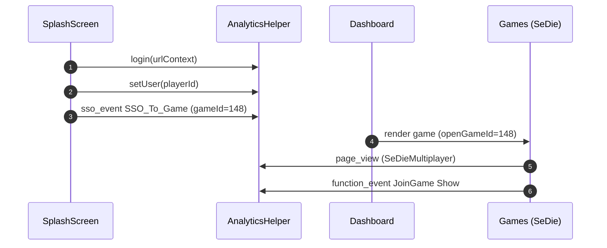

### Analytics Events and Telemetry: Bootstrap → Dashboard → Game Join

This document captures analytics signals observed during the flow from app bootstrap to game join for `gameId=148 (SeDieMultiplayer)`.

---

### Event Timeline

-   SplashScreen initialization
    -   `login(urlContext)`
    -   (post-preload) `setUser(playerId)`
    -   (post-preload) `sso_event` SSO_To_Game
-   Dashboard → Games render (SeDieMultiplayer)
    -   `page_view` page_title=SeDieMultiplayer
    -   `function_event` JoinGame:Show



---

### Events and Properties (from logs)

-   **login**
    -   Input: `urlContext` { token, gameId: 148, language: null, redirectUrl: null }
-   **setUser**
    -   Property: `user_id` / `playerId = ONEworksVGCash_5526892`
-   **sso_event**
    -   Payload: `{ ssoMethod: 'SSO_To_Game', gameId: 148, language: null, gameName: 'SeDieMultiplayer', playerId: 'ONEworksVGCash_5526892' }`
-   **page_view**
    -   Payload: `{ page_title: 'SeDieMultiplayer' }`
-   **function_event** (JoinGame)
    -   Payload: `{ function: 'JoinGame', action: 'Show', page: 'SeDieMultiplayer', playerId: '' }`
    -   Note: `playerId` appeared empty in this event in the logs.

---

### Instrumentation Guidance

-   **Ensure identity continuity**
    -   Populate `playerId` consistently across all events (e.g., `function_event`).
-   **Event ordering**
    -   Keep `setUser` before any game-specific events for reliable attribution.
-   **Environment gating**
    -   Gate verbose analytics logs and debug prints behind environment flags.
-   **Delivery guarantees**
    -   Queue and retry transient failures; flush on page-hide/visibilitychange.
-   **Context enrichment**
    -   Include `gameId`, `gameName`, `language`, and `appType` on game-related events.

---

### Minimal Payload Examples

```json
{
    "event": "sso_event",
    "payload": {
        "ssoMethod": "SSO_To_Game",
        "gameId": 148,
        "gameName": "SeDieMultiplayer",
        "language": "vi",
        "playerId": "ONEworksVGCash_5526892"
    }
}
```

```json
{
    "event": "function_event",
    "payload": {
        "function": "JoinGame",
        "action": "Show",
        "page": "SeDieMultiplayer",
        "playerId": "ONEworksVGCash_5526892",
        "gameId": 148
    }
}
```

---

### Related Docs

-   `docs/End_to_End_Bootstrap_Dashboard_Game_Flow.md`
-   `docs/URL_Context_and_SplashScreen_Flow.md`
