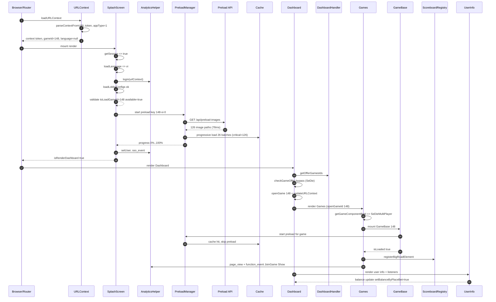

### End-to-End App Flow: URL → Splash → Preload → Dashboard → Game Mount (SeDieMultiplayer)

This document describes the observed runtime flow from initial URL parsing through SplashScreen initialization, resource preloading, Dashboard rendering, and final game mount for `gameId=148` (SeDieMultiplayer). It is derived from the provided console logs.

---

### Overview

-   **Input context**: `?token=<uuid>&appType=1`, persisted `gameId=148`
-   **Language**: `vi`
-   **Preload**: 126 critical images in 26 batches, 100% completion, cached
-   **Dashboard**: Offer check bypassed due to explicit query game (SeDie)
-   **Game**: `SeDieMultiplayer` mounted via `GameBase`; in-game preload is a cache hit
-   **Analytics**: login, setUser, SSO event, page_view, function_event JoinGame:Show

---

### Sequence Diagram

---

### Detailed Flow

-   **URLContext**

    -   **parseContextFromURL** sees `token`, `appType=1` and returns `{ token, gameId: 148, language: null }`.
    -   Subsequent loads often prefer `contextFromLocalStorage` when no query params are present.

-   **SplashScreen**

    -   **getSession** with token → `true`.
    -   **loadLanguage** selects `vi`.
    -   **authorize session** and **loadLobbyConfigs** complete successfully.
    -   Game validation resolves `toLoadGameId=148`, `isGameAvailable=true`.

-   **PreloadResources (App-level)**

    -   Calls `/api/preload-images` and receives 126 paths in ~78ms.
    -   Progressive load runs in 26 batches, all critical, no failures.
    -   Progress reaches 100%; cache marked warm for `gameId=148`.

-   **Dashboard**

    -   Renders with `openGameId` unset initially; then calls `openGame(148)`.
    -   Updates URL context with `gameId=148`.
    -   Bypasses offer check because query game is SeDie.

-   **Games → GameBase (SeDieMultiplayer)**

    -   Resolves component via `getGameComponentById(148)`.
    -   In-game `PreloadResources` detects cache hit and skips loading.
    -   Scoreboard and UI listeners initialize; user info reflects lobby vs in-game cursor class changes.

-   **Analytics**
    -   `login(urlContext)`, `setUser(playerId)`, `sso_event` for SSO_To_Game.
    -   `page_view` for SeDieMultiplayer and `function_event` JoinGame:Show.

---

### Timings and Counts (from logs)

-   **Preload API**: 78ms (126 image paths)
-   **Progressive load**: 26 batches (critical=126) → 100%
-   **Reported total preload time**: ~576ms
-   **Offer games count**: 124

---

### Notable Side Effects

-   **URL**: `updateURLContext({ gameId: 148 })` on openGame
-   **Cache**: App-level warmup ensures in-game preload is a cache hit
-   **UI**: UserInfo registers listeners; cursor class toggles for lobby vs in-game

---

### Recommendations

-   **Reduce duplicate URLContext parsing** within a single render cycle; memoize where feasible.
-   **Throttle or gate verbose per-image logs** behind a debug flag to minimize console noise.
-   **Review Games re-renders**; apply memoization and stable props to avoid unnecessary rerenders.
-   **Add error metrics for critical asset failures** even if rare (0 failures in observed run).

---

### Hard-coded `gameId = 148` touchpoints that enable this workflow

-   `src/_shared/react-contexts/url-context.ts`

    -   Default `gameId` to 148 when query param is missing/invalid, ensuring the app always has a valid target game.
    -   Snippet:
        -   `if (!gameIdParam || Number.isNaN(gameId) || gameId <= 0) { gameId = 148; }`

-   `src/components/page-components/splash-screen/index.tsx`

    -   Uses 148 as a fallback game when none provided or invalid; bypasses availability validation for SeDie (148); and falls back to 148 if game is not available, guaranteeing the flow continues to SeDie.
    -   Snippets:
        -   Fallback when missing: `if (!toLoadGameId || toLoadGameId === 0) { toLoadGameId = 148; }`
        -   Bypass validation: `let isGameAvailable = toLoadGameId === 148;`
        -   Fallback when unavailable: `if (!isGameAvailable) { toLoadGameId = 148; }`

-   `src/_shared/constants/index.ts`

    -   Declares the canonical constant: `GameIds.SeDie = 148`.

-   `game-settings.json`

    -   Static mapping: `"148": { id: 148, gameName: "SeDieMultiplayer", ... }` used to resolve the component and resources.

-   `src/components/game-base/index.tsx`

    -   Special-cases payload format for SeDie: `betPayloadFormat` is `"single"` when `id === 148`, otherwise `"map"`.

-   `src/components/game-base/handlers/pf-wrapper/pf-wrapper.tsx`

    -   Forces `clientSeed` on bet events for SeDie: `if (props.gameId === 148 && event === "bet") { ... }`.

-   `src/games/sedie-multiplayer/scoreboard-elements.tsx`

    -   Registers scoreboard element strictly for 148: `registerBigRoadElement(..., 148);`.

-   `src/styles/main.scss`
    -   Layout rules scoped to `.game-148` (cosmetic, but still an ID-based special case).

Note: Tests also reference `148` extensively to verify defaulting and behavior; they are not runtime gates but confirm the above logic.

---

### Related Docs

-   `docs/URL_Context_and_SplashScreen_Flow.md`
-   `docs/PRELOAD_PERFORMANCE_IMPROVEMENTS.md`
-   `docs/round-state-handler-and-timeline.md`
