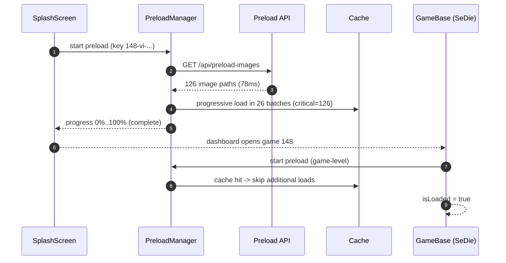

### Preload and Cache Behavior for Game Assets (gameId=148, locale=vi)

This document explains how the application preloads and caches game assets, based on the observed flow for `SeDieMultiplayer`.

---

### Summary of Observations

-   **API**: `/api/preload-images` returned 126 image paths in ~78ms.
-   **Progressive loading**: 26 batches, all critical priority (126/126 succeeded, 0 failed).
-   **Completion**: Reached 100%; game 148 marked as cached.
-   **In-game check**: Subsequent `PreloadResources` detected `isAlreadyCached=true` and skipped.

---

### Flow Diagram



---

### Cache Keys and Busting

-   Observed key structure includes `gameId`, `locale`, and a fingerprint of game icon IDs/banners (e.g., `148-vi-[...]-0`).
-   Asset URLs carry a cache-busting version query (e.g., `?v=1754980258792`).
-   Recommendations:
    -   Derive cache key as: `${gameId}-${locale}-${assetVersion}` to avoid overly long keys.
    -   On asset version change, invalidate only impacted entries (scoped busting).

---

### Priority and Concurrency

-   Current run marks all 126 assets as critical. Consider:
    -   **Tiered priority**: critical (above-the-fold), high (first interaction), medium, low (cosmetic/rare).
    -   **Adaptive batching**: start at 4–6 concurrent loads; increase/decrease based on success latency.
    -   **Yield to UI**: schedule batches via `requestIdleCallback` or small `setTimeout` gaps under load.

---

### Metrics to Track

-   `apiTimeMs` for `/api/preload-images` (observed ~78ms)
-   `progressTotal` = 126, `progressLoaded`, `progressFailed`
-   `totalPreloadTimeMs` (observed ~576ms)
-   `cacheHit` (boolean), `cacheAgeMs`
-   `firstPaintAssetsLoaded` (count and time)

---

### Error Handling and Resilience

-   Retry transient network errors with exponential backoff (2–3 attempts).
-   Record failed URLs and surface a compact summary in diagnostics.
-   Fallback to PNG if WebP fails (or vice versa) per asset-class policy.

---

### Example Telemetry Payloads

```json
{
    "event": "preload_complete",
    "payload": {
        "gameId": 148,
        "locale": "vi",
        "apiTimeMs": 78,
        "totalTimeMs": 576,
        "assets": { "total": 126, "critical": 126, "failed": 0 },
        "cacheWarmed": true
    }
}
```

```json
{
    "event": "preload_cache_hit",
    "payload": {
        "gameId": 148,
        "locale": "vi",
        "cacheHit": true,
        "cacheAgeMs": 0
    }
}
```

---

### Related Docs

-   `docs/End_to_End_Bootstrap_Dashboard_Game_Flow.md`
-   `docs/PRELOAD_PERFORMANCE_IMPROVEMENTS.md`
