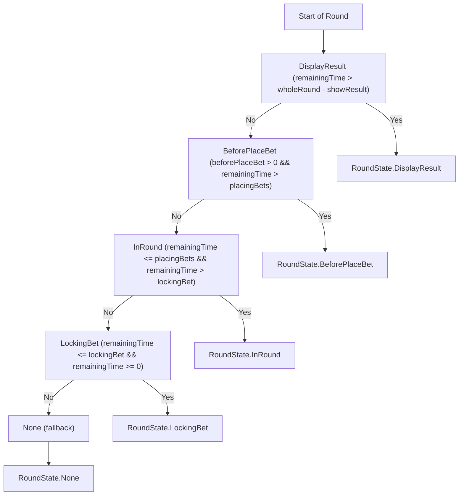
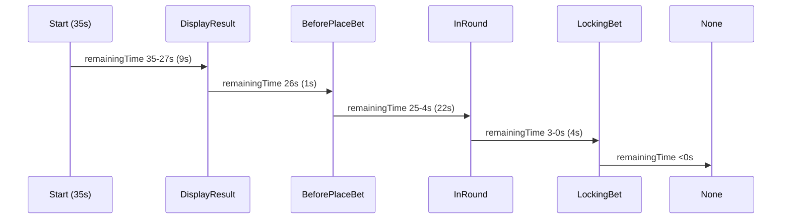

# RoundStateHandler: State Logic & Timeline

## Overview

`RoundStateHandler` is responsible for determining the current state of a game round based on timing and configuration. It uses the `GameDurations` object to segment the round into distinct phases, each represented by a `RoundState` enum.

**Important**: The timeline is based on `remainingTime` (countdown from `wholeRound` to 0), not elapsed time.

---

## State Determination Logic

The state is determined by the following logic:



---

## Timeline of a Whole Round

The round is divided into the following segments, based on `GameDurations` and `remainingTime`:

-   **DisplayResult**: `remainingTime > wholeRound - showResult` (remainingTime > 26)
-   **BeforePlaceBet**: `beforePlaceBet > 0 && remainingTime > placingBets` (remainingTime = 26)
-   **InRound**: `remainingTime <= placingBets && remainingTime > lockingBet` (4 <= remainingTime <= 25)
-   **LockingBet**: `remainingTime <= lockingBet && remainingTime >= 0` (0 <= remainingTime <= 3)
-   **None**: fallback (remainingTime < 0)

## Timeline Table (Consistent with actual implementation)

| State          | RemainingTime Range | Duration (sec) | Description                |
| -------------- | ------------------- | -------------- | -------------------------- |
| DisplayResult  | 35-27               | 9              | Show previous round result |
| BeforePlaceBet | 26                  | 1              | Brief pause before betting |
| InRound        | 25-4                | 22             | Active betting period      |
| LockingBet     | 3-0                 | 4              | Betting locked, countdown  |
| None           | < 0                 | -              | Invalid/error state        |

## Timeline Diagram (GitLab Compatible)

> **Note:** GitLab does not support Mermaid Gantt charts. The following sequence diagram is compatible with GitLab and visually represents the round timeline transitions based on remainingTime.



## Example: GameDurations

```ts
const durations: GameDurations = {
    wholeRound: 35,
    placingBets: 25,
    lockingBet: 3,
    showResult: 9,
    resultAnimation: 5,
    beforePlaceBet: 1,
};
```

## State Transition Examples

Based on the test cases:

-   **remainingTime: 32** → `DisplayResult` (32 > 26)
-   **remainingTime: 26** → `BeforePlaceBet` (26 > 25, beforePlaceBet > 0)
-   **remainingTime: 20** → `InRound` (20 <= 25 && 20 > 3)
-   **remainingTime: 2** → `LockingBet` (2 <= 3 && 2 >= 0)
-   **remainingTime: 0** → `LockingBet` (0 <= 3 && 0 >= 0)
-   **remainingTime: -1** → `None` (fallback)

---

## API

### determineRoundBaseState

Determines the current round state based on remainingTime.

**Params:**

-   `roundRemainingTime: number`
-   `wholeRound: number`
-   `remainingTime: number`
-   `durations: GameDurations`

**Returns:** `RoundState`

### getRemainingTime

Returns the current remaining time.

### getWholeRoundDuration

Returns the total duration of the round.
